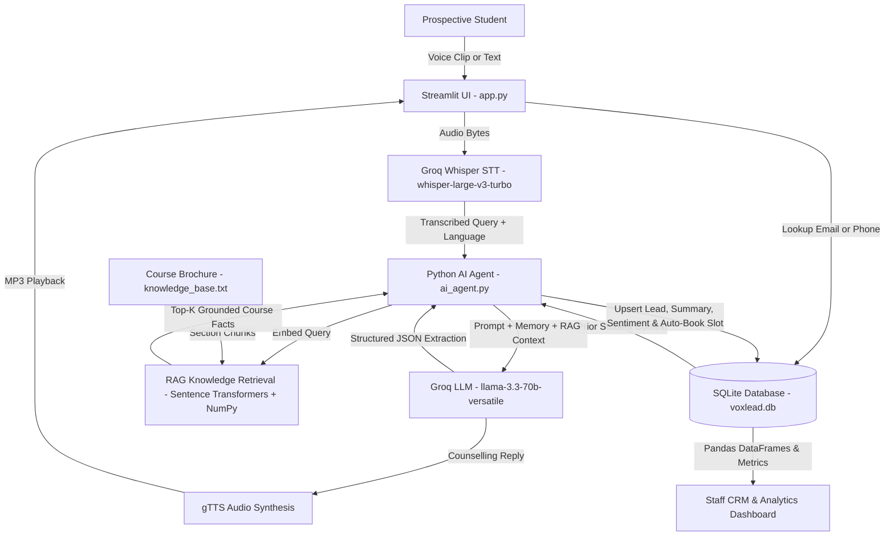

# System Architecture — VoxLead AI

## Overview

VoxLead AI follows a modular Python architecture separating presentation (`app.py`), AI & speech processing (`ai_agent.py`), course knowledge (`knowledge_base.txt`), and persistence/analytics (`database.py`).

## Architecture Diagram

## Component Responsibilities

1. **Streamlit Interface (`app.py`)**: Provides 6 dedicated views: Dashboard, AI Voice Assistant, Leads, Appointments, Call History, and Knowledge Base.
2. **Groq Whisper STT (`ai_agent.py`)**: Transcribes student voice recordings and detects language (`en`, `hi`, `te`).
3. **Sentence Transformers + NumPy RAG (`ai_agent.py`)**: Embeds sections of `knowledge_base.txt` with `all-MiniLM-L6-v2` and ranks top matches via NumPy cosine similarity so fees, duration, and syllabus are never fabricated.
4. **Contextual Memory (`database.py`)**: Looks up returning students by email or phone in SQLite and injects previous course interest, call summaries, and upcoming counselling bookings into the LLM system prompt.
5. **SQLite + Pandas (`database.py`)**: Enforces valid dates/slots, prevents duplicate counselling bookings, stores transcripts and summaries, and aggregates distribution metrics via Pandas.
